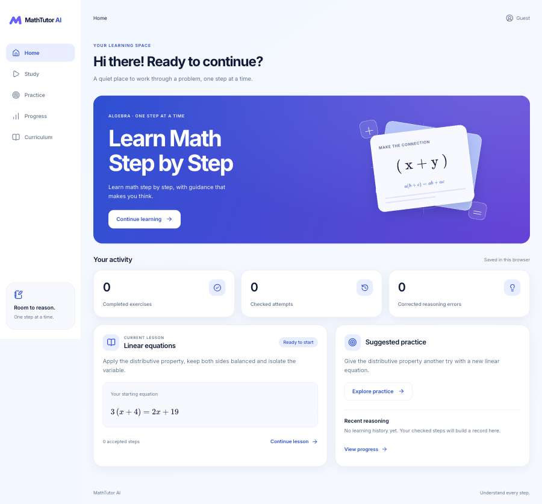
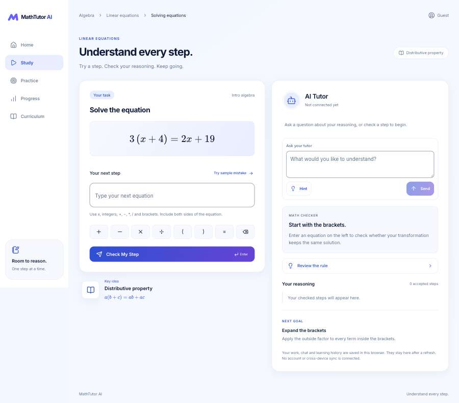
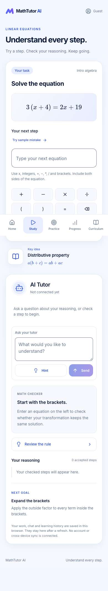
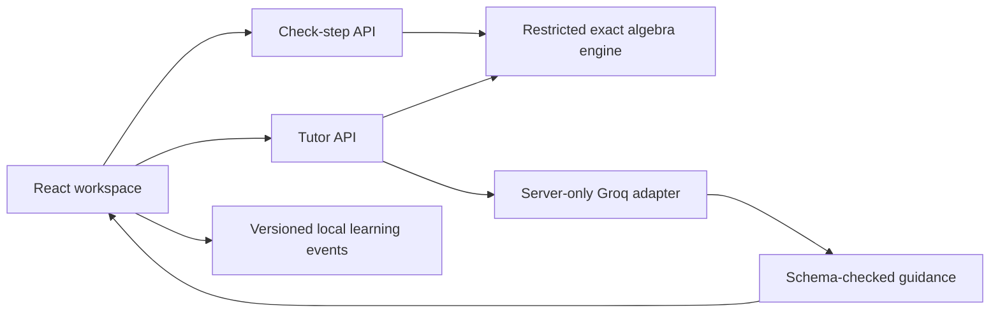

# MathTutor AI

An English-language algebra tutor prototype built with Next.js, React and TypeScript. Students submit actual equation transformations; a restricted deterministic engine checks the mathematics, while a separate server-side model adapter supplies Socratic guidance. Related practice and learning events persist in the same browser.

**Live demo:** [Open Study](https://math-tutor-ai-black.vercel.app/study) · [Home](https://math-tutor-ai-black.vercel.app/).

**No paid AI account is required.** The default provider is Groq Free with `openai/gpt-oss-120b`. Real local questions, progressive hints, chat, correction and completion have passed the server checks; a separate production-build request also passed. This is a small verified sample, not a reliability guarantee; automated tutor tests remain clearly separated mock scenarios. The deployed Vercel demo returned a real model response, and the owner confirmed the manual browser flow on 2026-11-09. See [free AI setup and evidence](docs/FREE_AI.md).

## Run locally

Use **Node 24.x** (`.nvmrc`, package and lockfile engines agree) and npm. Verified locally with Node 24.7.0 and npm 11.5.1. The browser tests use installed Google Chrome; no browser download is required.

```bash
npm ci
npm run dev
```

Open http://localhost:3000/study. `npm install` is available for development; `npm ci` preserves the locked install. A production preview uses `npm run build` followed by `npm run start`. Fonts are self-hosted and the build needs no AI key or provider request.

For real tutoring, create `.env.local` from `.env.example` only if it does not already exist, then configure it privately in your editor:

```dotenv
TUTOR_PROVIDER=groq
GROQ_API_KEY=
GROQ_MODEL=openai/gpt-oss-120b
GROQ_FREE_TIER_CONFIRMED=false
TUTOR_ENABLED=false
TUTOR_ALLOW_PAID=false
```

Create a key on the [Groq Free plan](https://console.groq.com/keys), without upgrading or adding billing. Keep that account on Free, enter its key privately, then set `GROQ_FREE_TIER_CONFIRMED=true` and `TUTOR_ENABLED=true`. Restart the server and run `npm run smoke:ai -- --allow-free` to send one real request. The confirmation flag records the owner's account check; the application cannot attest an external billing tier. Free quota exhaustion returns an honest error, never a paid fallback. [Groq billing](https://console.groq.com/docs/billing-faqs), [rate limits](https://console.groq.com/docs/rate-limits).

Never expose a key through `NEXT_PUBLIC_*`, browser code, chat or Git. A configured key alone is not proof of a working model. The legacy OpenAI adapter is retained, explicitly selected only with `TUTOR_PROVIDER=openai`, and blocked unless `TUTOR_ALLOW_PAID=true`; paid OpenAI is not needed for this assessment. See [AI configuration](docs/AI_INTEGRATION.md).

## Reviewer flow

1. Open Study: `3(x + 4) = 2x + 19`.
2. **Try sample mistake** fills `3x + 4 = 2x + 19` without submitting. Press Enter or **Check My Step**: the checker identifies omitted distribution and keeps the previous valid equation.
3. With functioning live AI, the tutor should ask a targeted question without revealing the solution. **Hint** progresses to a rule prompt, an unfinished checked operation, then an explicitly requested worked step. When AI is unavailable, that state is shown honestly; the static **Review the rule** reminder is labeled separately.
4. Submit `3x + 12 = 2x + 19`, then `x + 12 = 19`, then `x = 7`. Equivalent paths such as `3x - 2x = 19 - 12` are accepted. A direct verified final value is accepted with an invitation to show the expansion.
5. Related practice appears when the misconception is corrected and is prominent on completion. Open it, expand and solve its newly generated equation. For illustration, `5(y+2)=3y+18` has `y=4`; live generation varies rather than always returning that fixture.
6. Open Progress, refresh and navigate Home/Curriculum. Actual attempts, unique completed equations, corrections, hints and follow-up outcomes remain saved. **Try again** resets the current solution/chat while keeping event history. Clearing all saved history requires separate confirmation.

The equation keypad edits at the caret. Chat has an independent draft; asking a question is not a mathematical attempt. Loading blocks duplicates, failures preserve drafts, and explicit retries deduplicate successful actions. A full interaction-limit session can be restarted even with no accepted steps, without erasing recorded learning events.

## Actual interface captures

Fresh browser state, no seeded activity or model conversation. The pictured tutor says **Not connected yet**; these are UI captures, not evidence of live AI. Desktop captures use a 1440px viewport and are stored at 900px by the QA tool.





<details>
<summary>Mobile Study capture (390px viewport)</summary>



</details>

## Architecture and mathematical boundaries



Both APIs reconstruct a bounded starter/generated problem and replay the student's accepted equations or raw actions. Client correctness claims are rejected. Math grading and displayed worked formulas are independent of the model; public responses omit the internal canonical answer. The model has no tools, database or privileged actions. Its additional English-prose guard is conservative and heuristic, not a proof of every possible teaching claim.

The parser supports one variable (`x` or `y`), integers, unary signs, addition/subtraction, grouping, implicit/explicit multiplication and scalar division. Exact bounded BigInt rationals support fractional intermediate values. Solution sets are compared algebraically. Generalized omitted distribution is classified when supported by structural evidence; other rejected steps get neutral feedback. Syntax/no-op input does not become a misconception.

Functions, decimals, powers, multiple variables, variable denominators and arbitrary JS/TeX are unsupported. Bounds include 256 characters, 128 tokens, 16 nested groups/signs, 9-digit literals and bounded arithmetic magnitude. API bodies are streamed with 16 KiB/64 KiB limits. KaTeX receives controlled expressions with `trust:false`; model/student text is escaped.

Core modules: `src/lib/math/`, `src/lib/practice/`, `src/lib/tutor/`, `src/lib/learning/`, shared Study/Practice UI and two Node API routes. The SDK uses Responses Structured Outputs,15s timeout, 1200 output tokens, no automatic retries/logging and `store:false`. This storage flag does not claim all provider retention is disabled.

## Progress and limitations

Study/Practice solutions, drafts, chat and deduplicated events persist in versioned localStorage. Unknown/corrupt records are preserved with a notice; storage/quota/cross-tab failures are explicit. Counts reflect actual checked events. Practice accuracy excludes syntax/no-op input; follow-up accuracy explains its attempted-task denominator. These are practice measures, not certified mastery. See [event and storage semantics](docs/LEARNING_PROGRESS.md).

This MVP has one implemented lesson, no accounts, cloud sync, database, payments or analytics. A different browser starts empty. Browser-local data is editable by its owner and is not an authenticated school record. AI limits/cache are process-local and do not provide a durable global spend cap. **Do not expose billable AI publicly without an appropriate hosted/shared access and cost control.** See the [scoped security review](docs/SECURITY_REVIEW.md).

## Verification

```bash
npm run lint
npm run typecheck
npm run test
npm run build
npm run test:e2e
```

Current local results: **147 tests, 30 browser scenarios**, lint, strict typecheck and production build pass. The fresh post-provider browser run passed in the owner's Terminal in 39.5s. It covers desktop/tablet/mobile, including correction, progressive mock-provider guidance, transfer, refresh, failed requests, keyboard navigation and capped-session recovery. The test server forces live AI off; fixtures are only in `tests/`.

Read-only responsive QA passes all five routes at 1440/1024/768/390/360/375. Git history was scanned with redacted Gitleaks with no leak found. The official npm advisory endpoint returned an empty advisory set for the locked versions; the npm CLI itself was DNS-blocked. A restricted sandbox cannot run Playwright's localhost server; use an unrestricted Terminal.

The [ten-point acceptance report](docs/ACCEPTANCE_REPORT.md) records **ten local PASS criteria** with exact evidence. Genuine Groq guidance is verified locally and through the deployed API. The public hosted interface passed 25 responsive checks, and the owner confirmed the hosted manual flow. Mock tests remain separate evidence. Known tooling/CSP/hosting limits are explicit. [Design comparison](docs/DESIGN_REVIEW.md) and [implementation history/exact files](docs/IMPLEMENTATION_PROGRESS.md) contain supporting details.

## Submission, hosting and future platforms

A hosted reviewer uses the owner's server configuration and never receives or creates a provider key. The demo can use Groq Free within its actual account quota. The [Vercel demo](https://math-tutor-ai-black.vercel.app/study) is publicly reachable without a reviewer login. Hosted configuration, an actual model response and responsive routes were checked on 2026-11-09. The [release guide](docs/RELEASE_GUIDE.md) contains owner-run GitHub/Vercel instructions, access checks, a free-tier smoke test and rollback steps. [Infrastructure](docs/INFRASTRUCTURE.md) records what is planned versus verified.

Future Web/iOS/Android work would share pure TypeScript domain contracts and a hosted API, with React Native/Expo-specific phone UI rather than a wrapped desktop page. Authenticated backend storage would replace browser-only records for multi-device use. Production work also needs durable usage controls, provider evaluation, appropriate privacy/retention and broader curriculum support. No native app exists now.

All original private handoff files/reference PNGs remain unchanged and excluded from commits at the owner's request; a clone contains the implementation and new documentation. Real env files and build/test output are ignored. No push, deployment, domain or billing changes were performed by the agent.
